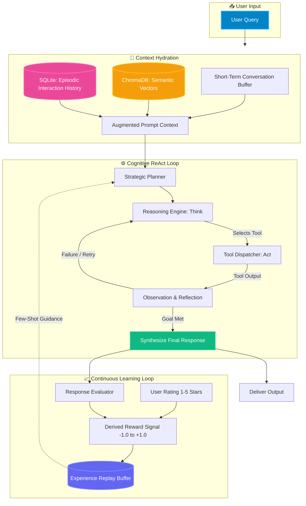

<div align="center">

<!-- Hero Banner -->


<!-- Typing Animation Subtitle -->
<p align="center">
  <a href="https://github.com/Viper-07/Self-Learning-AI-Agent">
    
  </a>
</p>

<!-- Tech Stack & Status Badges -->
<p align="center">
  
  
  
  
  
  
</p>

<p align="center">
  <a href="#-overview">Overview</a> •
  <a href="#-architecture">Architecture</a> •
  <a href="#-cognitive-cycle">Cognitive Cycle</a> •
  <a href="#-tiered-memory-system">Memory</a> •
  <a href="#-rest-api-endpoints">API</a> •
  <a href="#-quick-start">Quick Start</a> •
  <a href="#-security--sandbox">Security</a>
</p>

---

</div>

## 🌟 Overview

**Sentia** is not another simple LLM wrapper. It is a full-fledged **Autonomous Cognitive Agent** engineered with an introspective reasoning loop, strategic goal decomposition, multi-tiered contextual memory, and a continuous learning pipeline.

Rather than providing static single-turn responses, Sentia **plans**, **reasons**, **invokes tools**, **observes outcomes**, **self-reflects on errors**, and **learns from its own experiences** to continuously improve its future decision-making.

<br>

<div align="center">

### 🧩 Core Architecture Matrix

| Subsystem | Functional Role | Tech Stack | Indicator |
| :--- | :--- | :--- | :---: |
| **Strategic Planner** | Decomposes high-level ambiguous goals into ordered execution plans | LLM + Pydantic JSON Schema | 🗺️ |
| **Reasoning Engine** | Drives ReAct (*Think $\rightarrow$ Act $\rightarrow$ Observe*) with failure reflection | LiteLLM + Structured Output | ⚙️ |
| **Memory Manager** | Manages Short-Term, Semantic, Long-Term, and Episodic context | ChromaDB + SQLAlchemy Async | 💾 |
| **Learning Pipeline** | Experience replay buffer & reinforcement from user feedback | Experience Replay + Reward Signal | 📈 |
| **Tool Sandbox** | Secure execution of Python code, search, and file manipulation | Subprocesses + Sandboxed I/O | 🛡️ |

</div>

---

## 🧠 Cognitive Cycle

Sentia thinks and acts through a closed-loop reasoning pipeline:



1. **Plan 🗺️**: Decomposes complex multi-step queries into atomic, measurable milestones.
2. **Reason ⚙️**: Selects the optimal tool and inputs based on previous steps and retrieved knowledge.
3. **Act 🛠️**: Dispatches sandboxed tools (Python code execution, DuckDuckGo search, safe calculator, file system).
4. **Observe 👁️**: Parses execution outputs, handles edge cases, and logs observations.
5. **Reflect 🔄**: If an error or HTTP failure occurs, reflects on the cause and tries an alternate strategy.
6. **Learn 📈**: Evaluates success, captures the interaction in the Experience Replay buffer, and updates policies based on user feedback.

---

## 💾 Tiered Memory System

Sentia mirrors biological memory consolidation with four distinct tiers:

```
┌────────────────────────────────────────────────────────────────────────┐
│                        SENTIA MEMORY HIERARCHY                         │
├──────────────────┬─────────────────┬─────────────────┬─────────────────┤
│    Short-Term    │    Semantic     │    Long-Term    │    Episodic     │
│   (Context Bed)  │ (Concept Space) │ (Factual Store) │ (Episode Rec)   │
├──────────────────┼─────────────────┼─────────────────┼─────────────────┤
│ • Sliding window │ • Dense vectors │ • Persistent DB │ • Full traces   │
│ • In-memory FIFO │ • all-MiniLM-L6 │ • High-priority │ • Past failures │
│ • Token capped   │ • ChromaDB      │ • SQLite Async  │ • Strategy bank │
└──────────────────┴─────────────────┴─────────────────┴─────────────────┘
```

* ⚡ **Short-Term Memory**: In-process conversational buffer preserving immediate context.
* 🌐 **Semantic Memory**: ChromaDB vector index encoding facts, documentation, and conceptual definitions.
* 📚 **Long-Term Memory**: Relational persistence of curated, high-importance knowledge facts.
* 🎞️ **Episodic Memory**: Structured library of past completed episodes (user query, reasoning trace, tools used, reward outcome).

---

## 🔌 REST API Endpoints

Sentia ships with a production-ready **FastAPI** server:

| Method | Endpoint | Description |
| :---: | :--- | :--- |
| `GET` | `/health` | Health & readiness check returning agent status and LLM provider |
| `POST` | `/chat` | Standard chat interface returning formatted answer & latency |
| `POST` | `/chat/detailed` | Deep diagnostic response including full reasoning trace & tool outputs |
| `POST` | `/feedback` | Submits 1–5 star ratings to update the RL experience buffer |
| `GET` | `/conversations` | Lists past conversational sessions with metadata |
| `GET` | `/conversations/{id}` | Retrieves full message history for a conversation |
| `DELETE` | `/conversations/{id}` | Cascades deletion of conversation and all child messages |
| `GET` | `/memories` | Inspects stored persistent memories with optional type filtering |
| `GET` | `/skills` | Lists registered and learned dynamic skills |
| `GET` | `/tools` | Returns JSON Schema specifications for all active tools |

---

## 🛡️ Security & Sandbox

Sentia features an **Immune System** designed to eliminate Remote Code Execution (RCE) hazards:

* 🔒 **Restricted Python Built-ins**: The Python executor blocks dangerous modules (`os`, `sys`, `shutil`, `subprocess`, `socket`) and runs code with restricted globals.
* ⏱️ **Subprocess Isolation & Timeouts**: Script execution runs in sandboxed subprocesses enforced by strict execution timeouts.
* 📁 **Workspace Path Confinement**: The `file_manager` tool resolves paths strictly against `./data/workspace/` and raises `PermissionError` on path-traversal attacks (`../`).
* 🔐 **Transactional ACID Safety**: Relational database updates run with automatic rollback on error and enforced SQLite foreign-key cascading.

---

## 🚀 Quick Start

### 1. Clone & Setup Environment

```bash
# Clone the repository
git clone https://github.com/Viper-07/Self-Learning-AI-Agent.git
cd Self-Learning-AI-Agent

# Create and activate virtual environment
python -m venv venv
# Windows:
.\venv\Scripts\activate
# Linux/macOS:
source venv/bin/activate

# Install dependencies
pip install -r requirements.txt
```

### 2. Configure Environment Variables

Copy the example environment template and add your API keys:

```bash
cp .env.example .env
```

Edit `.env`:
```env
GEMINI_API_KEY=your_gemini_api_key_here
OPENAI_API_KEY=your_openai_api_key_here        # Optional
ANTHROPIC_API_KEY=your_anthropic_api_key_here  # Optional

DEFAULT_LLM_PROVIDER=gemini
DEFAULT_LLM_MODEL=gemini-1.5-pro
DATABASE_URL=sqlite+aiosqlite:///./data/agent.db
CHROMA_DB_PATH=./data/embeddings
```

### 3. Launch Sentia!

#### Mode A: Interactive Terminal CLI 💻
Experience Sentia directly in your console with rich live status animations, step breakdowns, and inline feedback:
```bash
python main.py --cli
```

#### Mode B: FastAPI REST Server 🌐
```bash
python main.py
```
* **Swagger UI Documentation**: [http://localhost:8000/docs](http://localhost:8000/docs)
* **Root Redirect**: [http://localhost:8000](http://localhost:8000) automatically forwards to Swagger Docs.
* **Alternative URL**: [http://127.0.0.1:8000](http://127.0.0.1:8000)

---

## 📂 Repository Structure

```text
├── agent/
│   ├── agent.py          # Primary Agent orchestrator & coordinator
│   ├── evaluator.py      # Automated response evaluator & reward scorer
│   ├── executor.py       # ReAct tool dispatcher & execution handler
│   ├── planner.py        # Strategic plan decomposer
│   └── reasoning.py      # ReAct reasoning loop (Think-Act-Observe)
├── database/
│   ├── database.py       # Async SQLAlchemy engine & session factory
│   ├── models.py         # Declarative ORM schemas (7 entities)
│   └── crud.py           # Decoupled domain CRUD operations
├── learning/
│   ├── experience.py     # Experience capture & replay buffer
│   └── feedback.py       # Human feedback processor & policy updater
├── memory/
│   ├── episodic_memory.py# Structured interaction episode persistence
│   ├── long_term.py      # Relational + vector fact memory bridge
│   ├── memory_manager.py # Unified memory facade
│   ├── semantic_memory.py# ChromaDB dense vector store
│   └── short_term.py     # Sliding window conversation memory
├── models/
│   ├── embeddings.py     # Async SentenceTransformer service
│   ├── llm.py            # LiteLLM unified multi-provider client
│   └── schemas.py        # Canonical Pydantic v2 DTO schemas
├── tools/
│   ├── calculator.py     # Safe math evaluation tool
│   ├── file_manager.py   # Sandboxed workspace file manager
│   ├── python_executor.py# Isolated Python execution sandbox
│   ├── tool_manager.py   # Dynamic tool registry & discovery
│   └── web_search.py     # Async DuckDuckGo search & scraper
├── main.py               # Unified application entry point (FastAPI + CLI)
├── config.py             # Type-safe pydantic-settings configuration
└── requirements.txt      # Pinned dependency manifest
```

---

<div align="center">

<!-- Footer Banner -->


<p align="center">
  <sub>Built with ❤️, ⚡, and Python for the next generation of Autonomous AI Agents.</sub>
</p>

</div>
